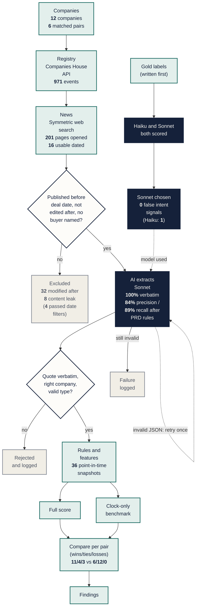
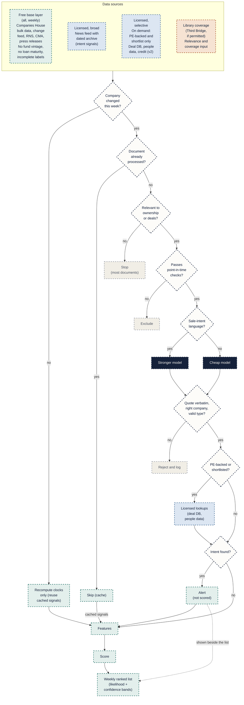

# Architecture

**Architecture A** was built and tested in the proof of concept (6 matched pairs). **Architecture B** is the **proposed** production design for about 100,000 UK private companies; **nothing in B is claimed as built**. Costs, volumes, coverage and predictive lift for B are **unvalidated**. Results in A are hypothesis-generating, not validation (see [findings](findings.md)).

## Architecture A: proof of concept (built and tested)

*Legend: green = built stage; navy = AI or model; diamond = decision; grey = excluded or rejected; dotted arrow = retry or loop; bold = number from a data file.*

*Data collected for validation only. Web search was the test method, not the production plan.*

Sources of every number: `data/cases/companies.json` and `pairs.json` (12 companies, 6 pairs); `data/processed/charts/evidence_funnel.json` (971 events, 201 pages opened, 16 usable dated); `docs/evidence_log.md` (32 modified-after pages, 8 content-leak pages, and the line recording that 4 of the 32 would have passed date filtering alone); `data/processed/charts/extraction_compare.json` (verbatim rate, precision and recall after the two PRD-derived rules, and false direct-intent signals: Sonnet 0, Haiku 1); `data/processed/features.json` (36 snapshots); `data/processed/scores.json` and [findings](findings.md) (win/tie/loss counts). A test checks that each number in the diagram matches its file.

## Architecture B: 100,000 companies (proposed, not built)

Both diagrams are proposals: every node is dashed. Stage names follow the slides: Registry (free base layer), News (licensed, broad), AI extracts (the two models and the output check), Rules (features and score), Ranked list.

### B1: weekly processing

*Legend: green dashed = free data or processing; blue dashed = licensed; orange dashed = Third Bridge internal; navy dashed = model; diamond = decision; grey dashed = stop or reject. All dashed = proposed, not built.*

Deterministic features (including holding-period clocks) are recomputed for every company every week; only LLM extraction reuses cached evidence (PRD section 9). Selective licensed lookups run on demand for PE-backed companies and the shortlist, not continuously on all 100,000: a private-markets/deal database (sponsor entry, fund vintage, deal history), people and job-postings data, and credit/loan data (v2). The three source groups plus the internal Library coverage input sit side by side at the top and are linked to the flow as one block.

### B2: feedback loops

```mermaid
flowchart TD
    subgraph L5["5. Business check"]
        LOGS["Client request logs<br/>(evaluation only)"]
        RR["Research ready<br/>before client<br/>asked?"]
        BTM["Backtest<br/>metrics"]
        LOGS -->|"Solely to measure research readiness. Never a feature or training signal."| RR
        RR --> BTM
        BTM -.->|"next period"| RR
    end
    subgraph L4["4. Extraction quality"]
        MON["Monitoring<br/>spot-checks vs<br/>gold set"]
        Q10{"Accuracy<br/>dropped?"}
        REV["Revise prompt<br/>or model"]
        OK["Keep as is"]
        MON --> Q10
        Q10 -->|"yes"| REV
        Q10 -->|"no"| OK
        REV -.->|"re-test"| MON
        OK -.->|"next check"| MON
    end
    subgraph L3["3. Source gate"]
        CAND["Candidate<br/>source"]
        BT3["Backtest"]
        Q9{"Lifts hit rate<br/>or lead time<br/>enough to<br/>justify cost?"}
        KEEP["Keep in data<br/>acquisition"]
        DROP["Drop"]
        CAND --> BT3 --> Q9
        Q9 -->|"yes"| KEEP
        Q9 -->|"no"| DROP
        KEEP -.->|"re-test"| BT3
        DROP -.->|"next candidate"| CAND
    end
    subgraph L2["2. Recalibration"]
        DEALS["New deal<br/>announcements"]
        LABELS["Labels"]
        BT["Rolling backtest<br/>vs holding-clock<br/>benchmark"]
        UPW["Update weights<br/>or model"]
        SC2["Scoring"]
        DEALS --> LABELS --> BT --> UPW
        SC2 -->|"past scores"| BT
        UPW -.->|"new weights"| SC2
    end
    subgraph L1["1. Weekly refresh"]
        SCHED["Weekly<br/>schedule"]
        UPD["Registry and<br/>news updates"]
        WP["Weekly processing<br/>(diagram B1)"]
        WRANK["Weekly<br/>ranked list"]
        SCHED --> UPD --> WP --> WRANK
        WRANK -.->|"next week"| SCHED
    end
    classDef free fill:#E3EFEC,stroke:#1D6B63,stroke-width:2px,color:#15213A,stroke-dasharray:5 5
    classDef licensed fill:#DCE6F2,stroke:#2F5D8C,stroke-width:2px,color:#15213A,stroke-dasharray:5 5
    classDef internal fill:#F6E3D3,stroke:#A54A15,stroke-width:2px,color:#15213A,stroke-dasharray:5 5
    classDef decisionB fill:#FDFCF9,stroke:#15213A,stroke-width:2px,color:#15213A,stroke-dasharray:5 5
    classDef excludedB fill:#F1EEE6,stroke:#8A8F99,stroke-width:2px,color:#4A5160,stroke-dasharray:5 5
    classDef aiB fill:#15213A,stroke:#15213A,stroke-width:2px,color:#F6F4EE,stroke-dasharray:5 5
    class SCHED,UPD,WP,WRANK,DEALS,LABELS,BT,UPW,SC2,BT3,MON,OK free
    class CAND,KEEP licensed
    class LOGS,RR,BTM internal
    class Q9,Q10 decisionB
    class DROP excludedB
    class REV aiB
```

*Legend: as above; dotted arrow = the loop returns to its start. Each loop is independent; client request logs appear only in loop 5 and link only to the readiness check.*

## Design rules
1. **Licensed data only, no scraping** (for example, no LinkedIn scraping). Respect every source's terms of use.
2. **Every vendor must provide as-of (historical) snapshots.** Deal-database labels need historical event dates; otherwise backtests leak the future.
3. **Free base layer on everything, licensed lookups targeted** at PE-backed companies and the shortlist.
4. **Every source is gated by backtest lift.** It stays only if it lifts hit rate or lead time enough to justify its cost.
5. **Same core logic as the PoC:** point-in-time rules, verbatim-quote and company checks, transparent score, the LLM only extracts and never produces a probability.

## Why each source
| Source | PoC finding that justifies it |
|---|---|
| Licensed news with a dated archive | Intent never appeared before the last 3 months (0 of 36 snapshot rows), and free news was thin: 16 usable dated articles vs 628 usable registry events ([findings](findings.md), 3 and 4). |
| Private-markets / deal database | No PE fund age in free data; only 6 labelled deals; two of the four sponsor entries are announcement-based proxies (PTSG, Xeinadin). |
| People and job-postings data | 0 of 532 officer events carry a job title, so a new CFO or chair cannot be detected from the registry (finding 6). Job postings can only be collected going forward, so they cannot be backtested (PRD section 8). |
| Credit/loan data (v2) | The free layer has no loan maturity. But debt events were frequent at controls and added noise, so this stays v2 and behind the source gate. |
| Source gate | Debt events: 3 wins rest on them alone and all 3 losses came with a control's debt event (finding 2). Signals that do not lift results should be dropped. |
| Library coverage | **Not a PoC finding.** A design requirement from PRD sections 12 and 13: research priority needs "not yet covered", and the business metric is coverage already in place. Subject to permission. |

## Phased rollout
Each phase is gated by measured lift against the holding-clock benchmark.
1. **Free base layer** (Companies House, RNS, CMA, press releases): clocks for every company.
2. **Licensed news with an archive:** intent signals.
3. **Private-markets / deal database:** fund age, more labelled deals, and a real backtest.
4. **People and job-postings data:** readiness signals.

## Assumptions to validate
- News-licence cost and archive depth.
- Latency and freshness of licensed news vs registry data.
- Entity-matching accuracy at 100,000 companies.
- Completeness of the PE-firm list.
- Real weekly document volumes.
- Whether vendors truly provide point-in-time history.
- Compliance's view on any future use of demand data (client request logs stay evaluation-only).
