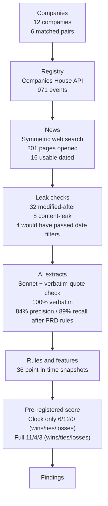
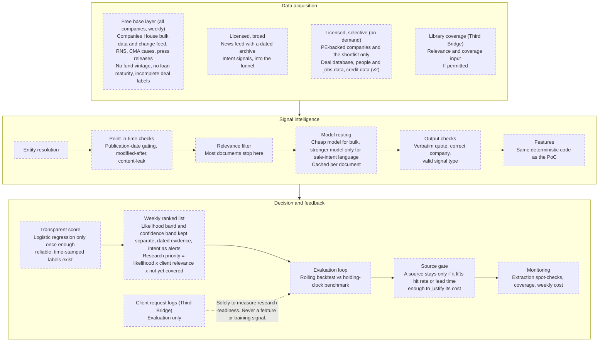

# Architecture

**Architecture A** was built and tested in the proof of concept (6 matched pairs). **Architecture B** is the **proposed** production design for about 100,000 UK private companies; **nothing in B is claimed as built**. Costs, volumes, coverage and predictive lift for B are **unvalidated**. Results in A are hypothesis-generating, not validation (see [findings](findings.md)).

## Architecture A: proof of concept (built and tested)

*Data collected for validation only. Web search was the test method, not the production plan.*

Sources of every number: `data/cases/companies.json` and `pairs.json` (12 companies, 6 pairs); `data/processed/charts/evidence_funnel.json` (971 events, 201 pages opened, 16 usable dated); `docs/evidence_log.md` (32 modified-after pages, 8 content-leak pages, and the line recording that 4 of the 32 would have passed date filtering alone); `data/processed/charts/extraction_compare.json` (verbatim rate, precision and recall after the two PRD-derived rules); `data/processed/features.json` (36 snapshots); `data/processed/scores.json` and [findings](findings.md) (win/tie/loss counts). A test checks that each number in the diagram matches its file.

## Architecture B: 100,000 companies (proposed, not built)

All nodes are dashed: **proposed, not built**. Stage names follow the slides: Registry (free base layer), News (licensed, broad), AI extracts (model routing and output checks), Rules (features and score), Ranked list. The three source groups in Data acquisition are laid out side by side (a fourth box shows the internal Library coverage input). Selective licensed lookups are on demand for PE-backed companies and the shortlist, not continuous on all 100,000: they cover a private-markets/deal database (sponsor entry, fund vintage, deal history), people and job-postings data, and credit/loan data (v2).

## Design rules
1. **Licensed data only, no scraping** (for example, no LinkedIn scraping). Respect every source's terms of use.
2. **Every vendor must provide as-of (historical) snapshots.** Deal-database labels need historical event dates; otherwise backtests leak the future.
3. **Free base layer on everything, licensed lookups targeted** at PE-backed companies and the shortlist.
4. **Every source is gated by backtest lift.** It stays only if it lifts hit rate or lead time enough to justify its cost.
5. **Same core logic as the PoC:** point-in-time rules, verbatim-quote and company checks, transparent score, the LLM only extracts and never produces a probability.

## Why each source
| Source | PoC finding that justifies it |
|---|---|
| Licensed news with a dated archive | Intent never appeared before the last 3 months (0 of 36 snapshot rows), and free news was thin: 16 usable dated articles vs 628 usable registry events ([findings](findings.md), 3 and 4). |
| Private-markets / deal database | No PE fund age in free data; only 6 labelled deals; two of the four sponsor entries are announcement-based proxies (PTSG, Xeinadin). |
| People and job-postings data | 0 of 532 officer events carry a job title, so a new CFO or chair cannot be detected from the registry (finding 6). Job postings can only be collected going forward, so they cannot be backtested (PRD section 8). |
| Credit/loan data (v2) | The free layer has no loan maturity. But debt events were frequent at controls and added noise, so this stays v2 and behind the source gate. |
| Source gate | Debt events: 3 wins rest on them alone and all 3 losses came with a control's debt event (finding 2). Signals that do not lift results should be dropped. |
| Library coverage | **Not a PoC finding.** A design requirement from PRD sections 12 and 13: research priority needs "not yet covered", and the business metric is coverage already in place. Subject to permission. |

## Phased rollout
Each phase is gated by measured lift against the holding-clock benchmark.
1. **Free base layer** (Companies House, RNS, CMA, press releases): clocks for every company.
2. **Licensed news with an archive:** intent signals.
3. **Private-markets / deal database:** fund age, more labelled deals, and a real backtest.
4. **People and job-postings data:** readiness signals.

## Assumptions to validate
- News-licence cost and archive depth.
- Latency and freshness of licensed news vs registry data.
- Entity-matching accuracy at 100,000 companies.
- Completeness of the PE-firm list.
- Real weekly document volumes.
- Whether vendors truly provide point-in-time history.
- Compliance's view on any future use of demand data (client request logs stay evaluation-only).
